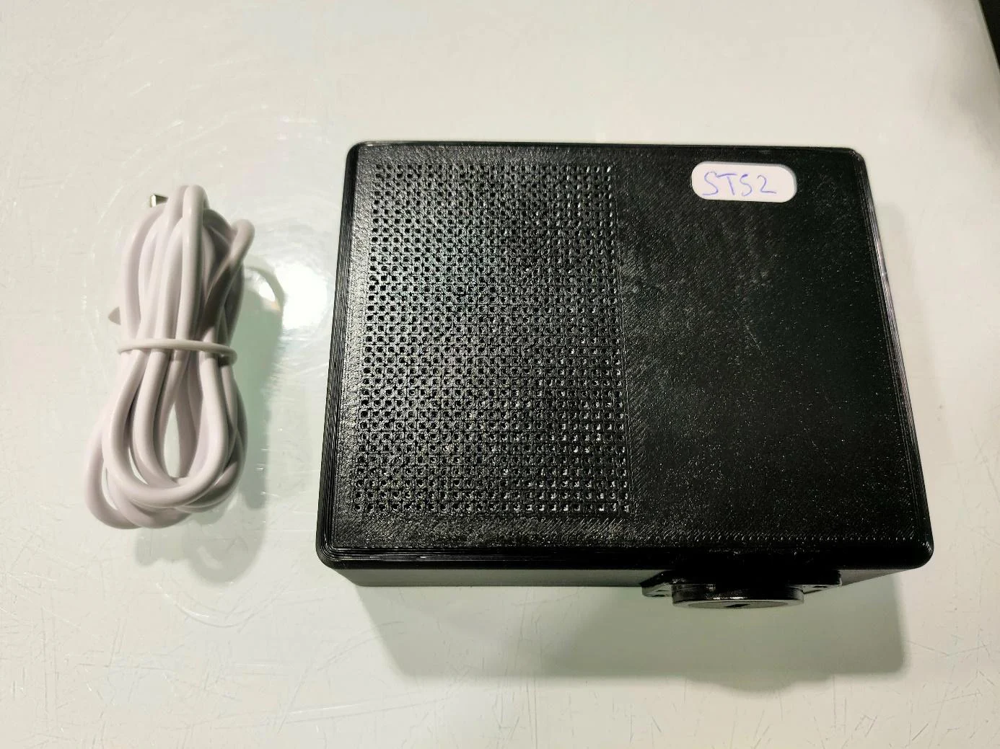
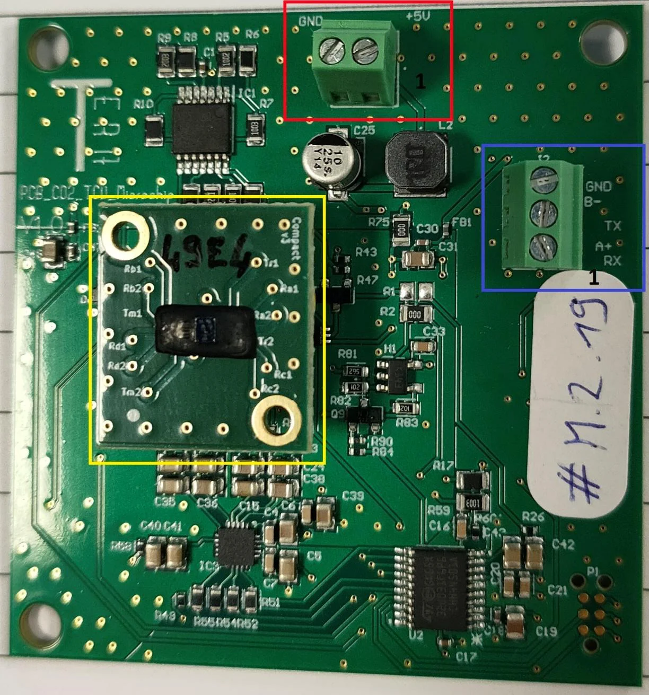
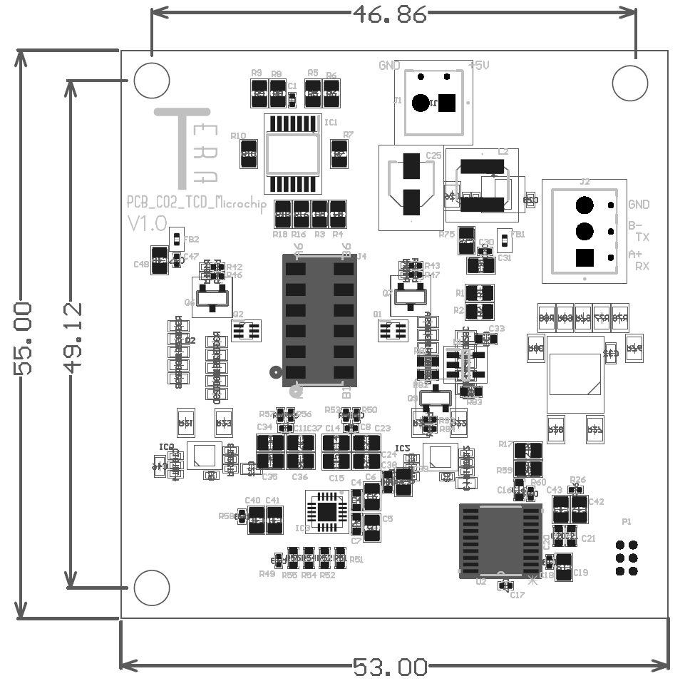
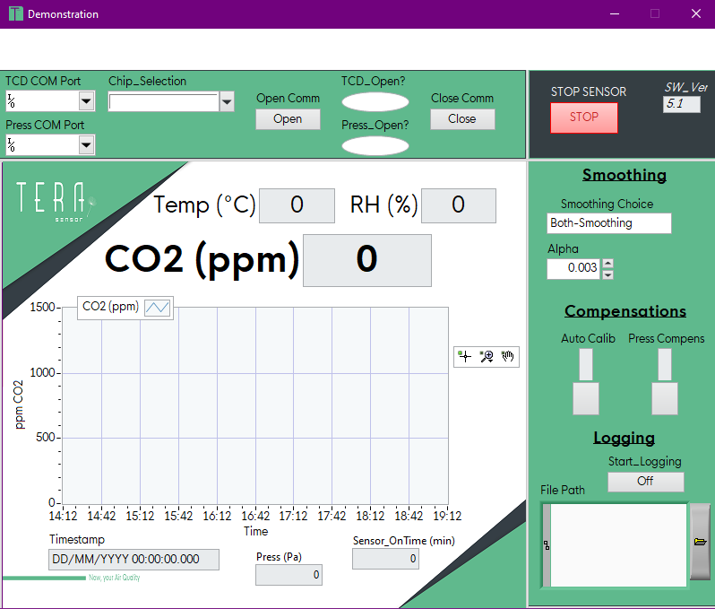


**This platform has moved.** The current version of this page is now published at [tera-sensor.com/resources/nextco2/user-guide/](https://tera-sensor.com/resources/nextco2/user-guide/).


# NextCO2 Demonstrator User Guide

## 1. Demonstrator kit 

_Figure 1: Demonstrator kit_

The demonstrator is shipped with a standard USB-C cable.

## 2. Hardware 

_Figure 2: Photo of the demonstrator PCB_

<mark style="color:yellow;">**Yellow rectangle**</mark> is the sensing cell’s PCB which is plugged on the demonstrator PCB.

<mark style="color:red;">**Red rectangle**</mark> is the power supply screw terminal. The figure 1 indicates pin n°1 of the terminal.

<mark style="color:blue;">**Blue rectangle**</mark> is the communication screw terminal. The figure 1 indicates pin n°1 of the terminal.

### 2.1 Connections 

Power Supply Screw Terminal:

<table><thead><tr><th width="144">Pin Number</th><th>Signal</th></tr></thead><tbody><tr><td><strong>1</strong></td><td>Power Supply Vcc</td></tr><tr><td><strong>2</strong></td><td>GND</td></tr></tbody></table>

Communication Screw Terminal:

<table><thead><tr><th width="140">Pin Number</th><th>Signal</th></tr></thead><tbody><tr><td><strong>1</strong></td><td>UART TTL Rx</td></tr><tr><td><strong>2</strong></td><td>UART TTL Tx</td></tr><tr><td><strong>3</strong></td><td>GND (only necessary if power supply and com are not connected together)</td></tr></tbody></table>

### 2.2 Characteristics 

Absolute Maximum Ratings:

|             |     | MIN  | MAX | UNIT |
| ----------- | --- | ---- | --- | ---- |
| **Voltage** | Vcc | -0.1 | 5.5 | V    |

Recommended Operating Conditions:

|         |             | MIN | NOM | MAX | UNIT |
| ------- | ----------- | --- | --- | --- | ---- |
| **Vcc** | Input Range | 4.8 | 5   | 5.2 | V    |

### 2.3 Communication Parameters 

The communication protocol is Modbus RTU on UART TTL levels with the following parameters:

| Baud Rate          | 115 200 |
| ------------------ | ------- |
| **Parity**         | Even    |
| **Stop bit**       | 1       |
| **Modbus Address** | 1       |

Supported Modbus functions are 0x03 and 0x10.

### 2.4 Sensor PCB 

Handle sensing cell’s PCB with care.

Do not touch directly the sensing cell.

Do not place the sensing cell in dusty environments.

When plugging the sensor cell’s PCB onto the demonstrator PCB, the white dot must be on the opposite side of the power supply screw terminal.

### 2.5 Mechanical integration 

_Figure 3: Mechanical dimensions of the demonstrator’s PCB_

Fixation hole size is 3.4 mm.

## 3. Software 

_Figure 4: Demonstration software_

### 3.1 Connect to demonstrator 

Browse the “Chip\_Selection” menu to find your sensor’s name (ex: ST-48). If the sensor’s name is not in the menu, refer to section 3.6 or contact Tera Sensor.

Select COM port on which the demonstrator is connected. You can find this port using the device manager, when the demonstrator is plugged, a new COM port appears.

Press the “Open Comm” button.

If the “TCD\_Open?” LED turns blue, the demonstrator has connected successfully. Else, either the COM port selected is not correct or the demonstrator is not powered.

A pressure sensor may be added to provide pressure compensation for more precise measurement. The sensor’s reference is: SEN0664 from DFRobot; the board must be configured in UART with 0x47 address. The sensor must be connected to the PC with an FTDI cable. The COM port can now be selected in “Press COM port” and the connection may be opened by pressing the “Open Comm” button.

The pressure sensor is not provided with the demo kit.

### 3.2 Data display and logging 

When the sensor is plugged, a message is displayed in the middle of the graph. That is because data is reliable only 24 hours after the sensor has been connected (minimal time for the auto calibration to be triggered).

The main screen shows the current measurement for Temperature, Relative Humidity and CO2. The only measurement plotted on the graph is the CO2 measurement.

The Timestamp indicator shows when latest measurement was acquired.

To start logging the data, press the “Start\_Logging” button. There are 2 possibilities:

* “File Path” was left blank: A new file is automatically created; the name is the date and time of the file’s creation. This file is a .csv file stored in the Data\_Log folder which is located in the same folder as application executable.
* “File Path” contained the path to a .csv file. The data will be written in this file below any data already written in it.

Warning: Do not write a path to a file which is not .csv.

### 3.3 Data smoothing 

This option allows data to be smoothed using an exponential smoothing with the “Alpha” value as parameter (default value is 0.01).

The “Smoothing Choice” allows 4 possibilities:

* No Smoothing: No smoothing is applied
* Pre-Smoothing: Exponential smoothing is applied to the raw data (before algorithm converts into environmental measurements)
* Post-Smoothing: Exponential smoothing is applied to the converted measurements
* Both-Smoothing: (default value) Exponential smoothing is applied to the raw data and the converted data.

Warning: Using the data smoothing slows down the sensor’s response time.

### 3.4 Auto Calibration 

The auto calibration algorithm may be enabled by turning on the Auto Calib switch.

When the auto calibration is enabled, the software checks if the file “auto\_cal.ini” exists in the same folder as the exe. If the chip ID exists in the file; the auto calibration offset is read and immediately used in the algorithm. Otherwise, a quick calibration is performed one hour after the auto calibration was enabled and the offset value is written in the file.

The auto calibration triggers every 24 hours of consecutive measurement; the lowest value measured is set to be 425 ppm of CO2.

Warning: The auto calibration algorithm should only be used if the sensor is exposed every day to a 425 ppm CO2 baseline.

### 3.5 Pressure Compensation 

Pressure compensation may only be activated if the pressure sensor is correctly connected.

### 3.6 Use of updated algorithm sent by TERA Sensor 

If a new algorithm is needed for the demonstrator, TERA Sensor will send you a file named “Reg\_Coeff.ini”.

First, it is necessary to close the application (section 3.7). Then, replace the file “Reg\_Coeff.ini” located in the same folder as the application by the new file sent by Tera Sensor.

The application can now be restarted and the demonstrator’s name should be available in the “Chip\_Selection” menu.

### 3.7 Closure of software 

First, stop the data logging if it was ongoing. Press the “Start\_Logging” button to stop the logging.

Then, if a demonstrator is connected, disconnect it by clicking the “Close Comm” button. “TCD\_Open?” should turn white.

Finally, close the application by pressing the “STOP SENSOR” button.

## Revision history 

| Date       | Revision | Changes                                      |
| ---------- | -------- | -------------------------------------------- |
| 2026/01/06 | 1.0      | Creation                                     |
| 2026/10/12 | 2.0      | Update with v5.3 Demo SW and Demo casing     |
